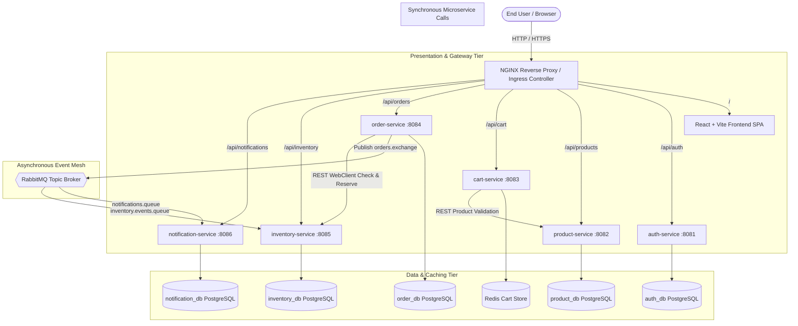
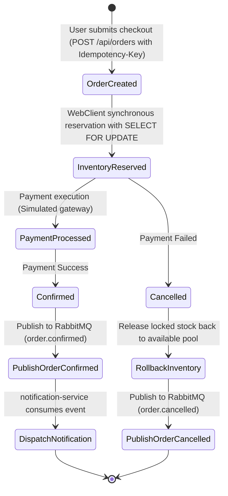
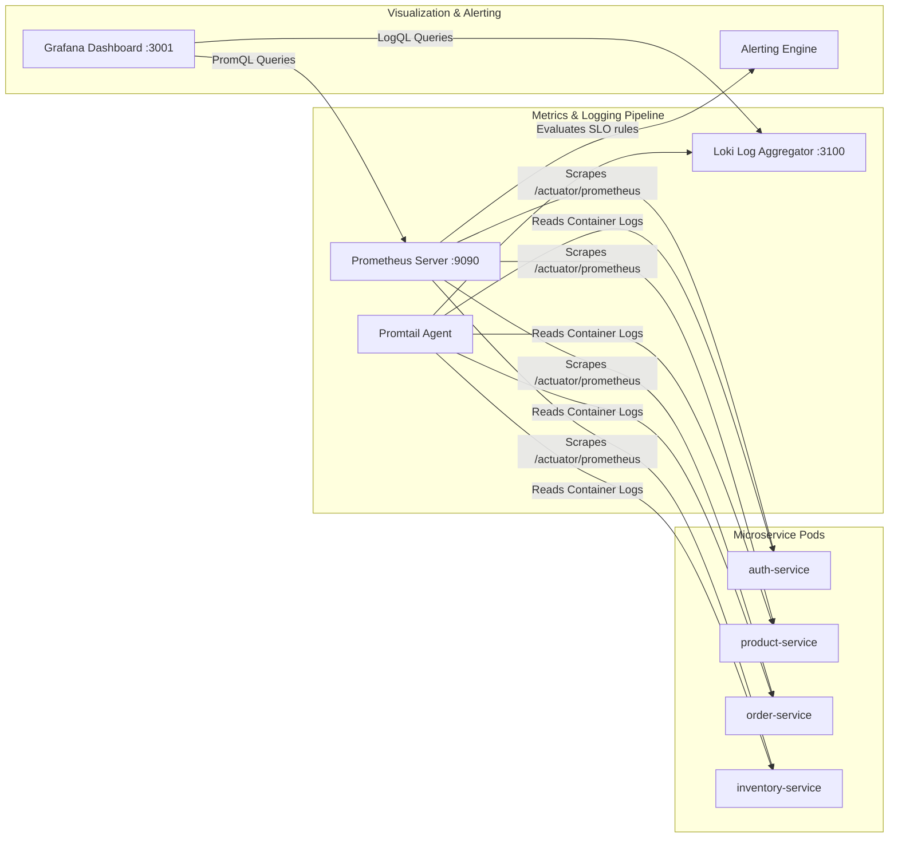

# System Architecture & Component Interaction
## ShopSphere / Go N Buy Platform

### 1. High-Level Architectural Diagram

---

### 2. Order Lifecycle & Event Orchestration State Machine

---

### 3. Observability Architecture

