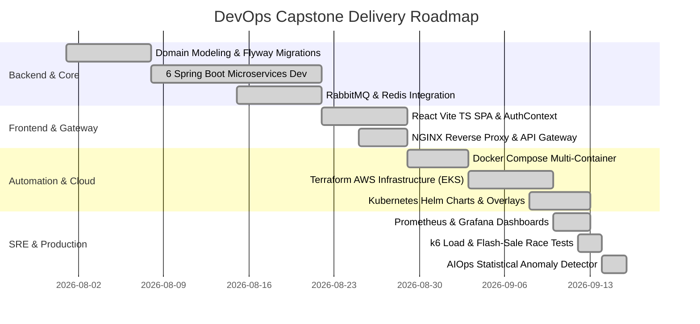

# Capstone Execution Roadmap & Milestones
## ShopSphere / Go N Buy Platform

This roadmap documents the 8-week production engineering delivery milestones from initial scaffold to production-ready multi-cloud deployment.

---

### Milestone Schedule

---

### Deliverable Verification Matrix

| Milestone | Deliverable | Status | Verification Command |
| :--- | :--- | :--- | :--- |
| **M1: Backend Services** | 6 Maven microservices (Java 21) | Complete | `mvn clean test` across all services |
| **M2: Data Layer** | PostgreSQL per service + Redis Cart | Complete | `docker compose -f docker-compose.dev.yml up -d` |
| **M3: Event Broker** | RabbitMQ topic exchange & DLQ | Complete | Verification via RabbitMQ UI (`:15672`) |
| **M4: Web Frontend** | React + Vite + TypeScript SPA | Complete | `npm run build` in `frontend/` |
| **M5: IaC** | Terraform VPC, EKS, RDS, Redis, IAM | Complete | `terraform validate` in `terraform/environments/dev` |
| **M6: K8s / Helm** | Helm chart + Kustomize dev/prod | Complete | `helm lint ./helm/shopsphere` |
| **M7: CI/CD & Sec** | GitHub Actions workflows | Complete | Trivy & Checkov automated scans passing |
| **M8: Observability** | Prometheus, Grafana, Loki, OTel | Complete | Dashboards visual on port 3001 |
| **M9: SRE & AIOps** | Anomaly detector & Load tests | Complete | `python aiops/anomaly-detector.py` & k6 execution |
